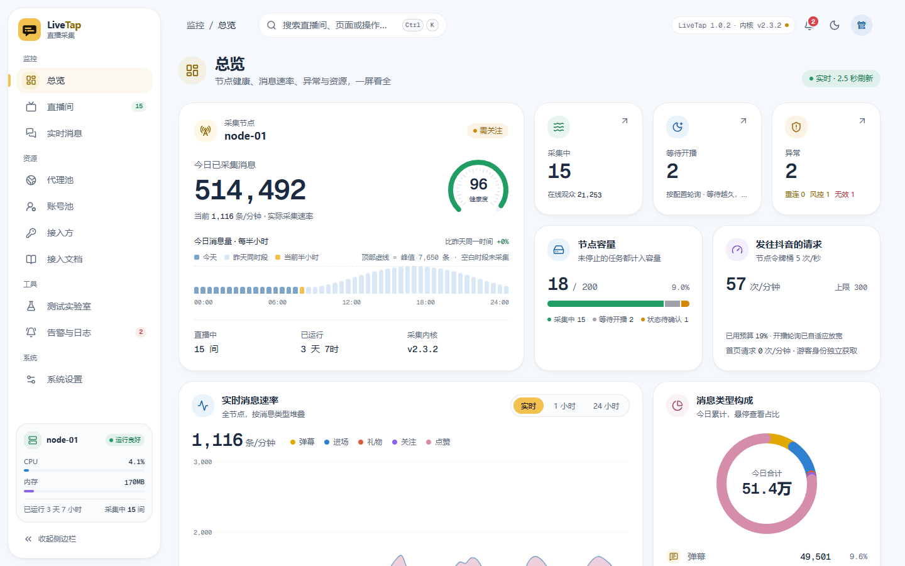
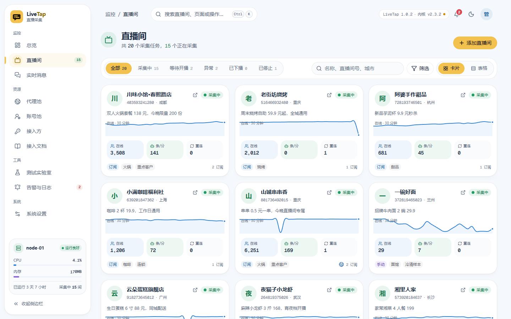
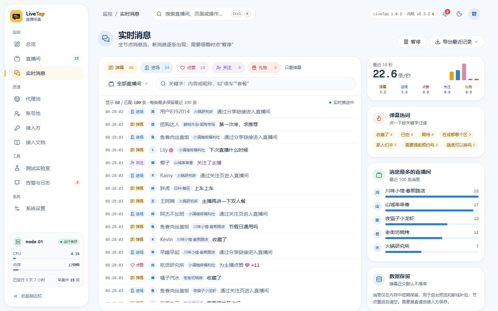
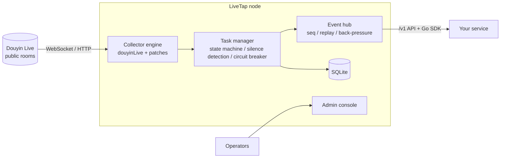

<div align="center">


# LiveTap

**A live-comment collector node for Douyin live streams**

Receives comments, joins, gifts, follows and other messages from public live rooms as a read-only viewer,<br/>
streams them to your own services over a standard HTTP + WebSocket API, and ships with a full admin console.

[](https://github.com/Vz7797/LiveTap/actions/workflows/ci.yml)


[](LICENSE)

[简体中文](README.md) | English

[Built on douyinLive](#built-on-douyinlive) · [Quick start](#quick-start) · [Integration](#integration) · [Documentation](#documentation) · [FAQ](#faq) · [Changelog](CHANGELOG.md)

</div>

---

> The admin console and the documentation under `docs/` are currently in Simplified Chinese.

## Overview

Many live-streaming products need the audience's messages in real time: an AI co-host replies to comments, interactive games count follows and gifts, dashboards track joins and viewer counts. LiveTap turns "connect to Douyin and receive messages" into a node you deploy on its own:

- **Your service focuses on business logic.** Subscribe to rooms through the northbound API and receive events in one uniform format over a single WebSocket, without dealing with Douyin's private protocol, signing or reconnects.
- **The node focuses on collection.** Every room is an independent task with its own state machine; going live, ending, disconnects and restrictions all surface as explicit states and events.
- **Scale out on demand.** Nodes are independent of each other. Add nodes as traffic grows; your service decides which room goes to which node.

## Built on douyinLive

LiveTap's collection engine comes from [jwwsjlm/douyinLive](https://github.com/jwwsjlm/douyinLive) (MIT), pinned at v2.3.2 and vendored in [third_party/douyinLive](third_party/douyinLive).

**Changes to the engine** (patches in [deploy/patches](deploy/patches); verify offline with `node deploy/verify-engine.mjs`):

- Hooks for HTTP requests, responses and WebSocket handshakes, used for the node's request budget and for detecting verification pages and restricted responses.
- An optional guest identity provider, so rooms sharing one egress can share a guest cookie.
- Room info is queried through the unsigned web/enter endpoint first; the live page and signed endpoints are fallbacks, which reduces verification prompts.

**Added on top of the engine**: multi-room task management and state machines, silence detection and restriction circuit breaker, the northbound API and Go SDK, the admin console, proxy and account pools, the test lab, alerts and logs.

## Screenshots

<picture>
  <source media="(prefers-color-scheme: dark)" srcset="docs/images/overview-dark.png" />
  
</picture>

<table>
  <tr>
    <td width="50%">
      <picture>
        <source media="(prefers-color-scheme: dark)" srcset="docs/images/rooms-dark.png" />
        
      </picture>
    </td>
    <td width="50%">
      <picture>
        <source media="(prefers-color-scheme: dark)" srcset="docs/images/messages-dark.png" />
        
      </picture>
    </td>
  </tr>
  <tr>
    <td align="center">Rooms</td>
    <td align="center">Live messages</td>
  </tr>
</table>

<sub>Screenshots use the built-in demo data; all shop names and messages are fictional.</sub>

## Features

**Reliable collection**

- One task and state machine per room: changing one room's settings rebuilds only that room.
- Adaptive silence detection with a corroborating connection, so a quiet room is not mistaken for a dead connection.
- Automatic end-of-stream detection: if a room does not go live again within 10 minutes, probing stops, resources are released and subscribers are notified.

**Gentle on the upstream**

- Node-wide request budget and start-rate limit.
- Only an explicit verification page or access denial triggers a node-wide cooldown, which pauses new probes and connections.
- Read-only: never posts comments, never likes, never solves captchas.

**Built for integrators**

- `/v1` northbound API: subscription leases, one upstream connection shared by several clients, `seq`-based replay after reconnects, explicit gap notices and bounded back-pressure.
- Subscription status heartbeats tell you whether each room is collecting, waiting to go live, ended or temporarily restricted.
- Go SDK with automatic reconnects, lease renewal and per-stream de-duplication.

**Complete operations**

- Admin console: overview, rooms, live messages, proxy pool, account pool, clients, alerts and logs, settings; dark theme and mobile layout included.
- Test lab: add rooms step by step and compare anonymous, proxy and account setups to measure a node's real capacity.
- Alert rules with webhooks, size-rotated logs and an audit trail.

**Secure by default**

- argon2id admin password, CSRF protection and per-source-IP login lockout.
- Proxies, account cookies and API keys are encrypted with AES-256-GCM; logs are redacted.
- The container runs as non-root on a read-only distroless image.

## How it works



A node is a single container: a Go backend with the React admin console embedded, storing its data in SQLite with no external database.

## Benchmarks

We ran several long tests on a 4-core, 4 GB cloud server in mainland China with 15 Mbps bandwidth, using anonymous guest access without proxies or accounts:

| Test | Duration | Subscriptions | Collecting | Events delivered | Gaps | Node cooldowns | CPU / memory |
|---|---|---|---|---|---|---|---|
| No-restart soak | 93 h | 100 | ~80–90 rooms | 64.2 M | 0 | 0 | ~0.3 core / ~0.5 GB |
| End-of-stream detection | 62 h | 100 | median 89 rooms | 46.8 M | 0 | 0 | median 0.27 core / 497 MB |

See [benchmark notes](docs/benchmark.md) (Chinese) for bandwidth, restrictions, latency and sizing advice.

## Quick start

### Docker (recommended)

Requires Docker and Docker Compose.

```bash
git clone https://github.com/Vz7797/LiveTap.git
cd LiveTap

# Master key that encrypts proxies, accounts and API keys. Keep it in a password manager;
# encrypted data cannot be recovered without it.
export LIVETAP_SECRET_KEY="$(openssl rand -base64 32)"
# Initial admin password (at least 12 characters); you must change it on first login.
read -rsp "Initial admin password: " LIVETAP_ADMIN_INITIAL_PASSWORD && export LIVETAP_ADMIN_INITIAL_PASSWORD

docker compose -f deploy/compose.yaml up -d --build
```

Open <http://127.0.0.1:8090> and sign in as `admin`. The node listens on localhost only by default; to reach it from other machines, put it behind an HTTPS reverse proxy as described in the [deployment guide](docs/deployment.md).

### Build from source

Requires Go 1.27, Node.js 24 and pnpm.

```bash
pnpm --dir web install --frozen-lockfile
pnpm --dir web build
go -C server build -o ../bin/collector ./cmd/collector
```

The frontend build is embedded into the backend, so the result is a single executable. See the [development guide](docs/development.md) for running, testing and maintaining the engine patches.

## Integration

1. Create an API key on the "Clients" (接入方) page of the admin console; it is shown only once.
2. Subscribe to rooms through the northbound API, then open the WebSocket event stream.

| Endpoint | Purpose |
|---|---|
| `GET /v1/node` | Node info, capacity and health, for choosing a node |
| `POST /v1/subscriptions` | Subscribe to a room, optionally to selected message types only |
| `POST /v1/subscriptions:renew` | Renew leases (renewed automatically while the stream is connected) |
| `POST /v1/rooms/status:batch` | Query the status of many rooms at once |
| `GET /v1/stream` | WebSocket event stream: messages, status heartbeats, gaps and replay |

Go services can use the SDK directly:

```bash
go get github.com/Vz7797/LiveTap/sdk/go
```

```go
c, _ := collector.New(nodeURL, apiKey)
sub, _ := c.Subscribe(ctx, collector.SubscribeRequest{LiveID: "123456789", EventTypes: []string{"chat", "member"}})
go c.AutoRenew(ctx, []collector.Subscription{sub}, nil)
_ = c.Stream(ctx, collector.StreamOptions{
    OnEvent: func(e collector.Event) error { fmt.Println(e.Type, e.Seq); return nil },
    OnGap:   func(collector.Event) { /* handle the gap as your business requires */ },
})
```

See [sdk/go/examples/minimal](sdk/go/examples/minimal/main.go) for a complete program, and the [integration guide](docs/integration-guide.md) for choosing and switching nodes, end-of-stream grace periods and de-duplication.

## Configuration

Common environment variables:

| Variable | Default | Description |
|---|---|---|
| `LIVETAP_SECRET_KEY` | required | Base64 of 32 random bytes; encrypts sensitive settings |
| `LIVETAP_ADMIN_INITIAL_PASSWORD` | required on first start | Initial admin password, at least 12 characters |
| `LIVETAP_LISTEN` | `0.0.0.0:8090` | Main listen address |
| `LIVETAP_ADMIN_LISTEN` | empty | Separate listen address for the admin console; bind it to an internal network |
| `LIVETAP_NODE_NAME` | `collector-01` | Node name |
| `LIVETAP_COOKIE_SECURE` | `false` | Set to `true` behind an HTTPS reverse proxy |
| `LIVETAP_TRUSTED_PROXIES` | empty | Comma-separated CIDRs of your reverse proxies |
| `LIVETAP_LAB_ENABLED` | `false` | Enables the test lab; keep it off in production |

The full list is in the [deployment guide](docs/deployment.md). Runtime settings such as proxies, accounts, capacity and rate limits are managed in the admin console.

## Documentation

| Document | Contents |
|---|---|
| [Deployment](docs/deployment.md) | Docker, environment variables, reverse proxy, backup and upgrades |
| [Integration guide](docs/integration-guide.md) | Choosing and switching nodes, message filtering, end-of-stream grace, de-duplication |
| [API reference](docs/api.md) | Admin and northbound APIs: requests, responses, error codes, event format, replay rules |
| [Benchmarks](docs/benchmark.md) | Test machine, capacity, bandwidth, restrictions and latency |
| [Design](docs/design.md) | Architecture, state machine, silence detection, request budget, data retention |
| [Development](docs/development.md) | Building, running locally, tests, engine patch maintenance |
| [UI guidelines](docs/ui-guide.md) | Colors, typography, motion and performance budget |

## FAQ

<details>
<summary><b>Do I need a Douyin account?</b></summary>

No. The node connects to public rooms as a guest and only receives messages. Accounts are optional and only worth considering when tests show that anonymous access is restricted; use a dedicated account, never a merchant's main account.
</details>

<details>
<summary><b>How many rooms can one node handle?</b></summary>

The default limit is 200 rooms and can be changed in the console. How many rooms a node handles reliably depends on its egress IP and on how busy the rooms are; measure it on your own server with the built-in test lab.
</details>

<details>
<summary><b>Will Douyin restrict the node?</b></summary>

Data-center IPs that send many requests in a short time may be asked for verification. LiveTap has a request budget, a start-rate limit and a node-wide cooldown to avoid that; if a restriction does happen, it pauses new requests and waits instead of trying to bypass verification.
</details>

<details>
<summary><b>Are comments stored?</b></summary>

Not long-term. Message bodies are kept in memory for a short window per room, for console previews and replay after reconnects; the database only stores per-minute counts. If you need to keep messages, store them on your side.
</details>

<details>
<summary><b>What about Kuaishou, TikTok or other platforms?</b></summary>

Only Douyin Live is supported today. The engine layer is replaceable, so other engines can be added later.
</details>

## Disclaimer

LiveTap only receives messages that any viewer of a public live room can see. It does not post content, like, solve captchas or bypass any platform security mechanism. You are responsible for complying with Douyin's terms of service and the laws that apply to you, for keeping collection at a reasonable scale, and for handling the collected data properly. You use this project at your own risk.

## Contributing

Issues, suggestions and pull requests are welcome in the open. See [CONTRIBUTING.md](CONTRIBUTING.md) for the workflow and commit conventions.

The only exception is security vulnerabilities: please report them privately as described in [SECURITY.md](SECURITY.md), so deployed nodes are not exposed before a fix is out. Once a fixed release is published, the issue and the fix are described publicly in the release notes.

## Acknowledgements

- [jwwsjlm/douyinLive](https://github.com/jwwsjlm/douyinLive): the collection engine, vendored at a pinned version with patches in [third_party/douyinLive](third_party/douyinLive) (MIT).
- [shadcn/ui](https://ui.shadcn.com/) and [beUI](https://beui.dev): component foundations of the admin console (MIT).

All third-party components and their licenses are listed in [THIRD_PARTY_NOTICES.md](THIRD_PARTY_NOTICES.md).

## License

LiveTap is released under the [MIT License](LICENSE). Third-party components remain under their own licenses; see [THIRD_PARTY_NOTICES.md](THIRD_PARTY_NOTICES.md).
