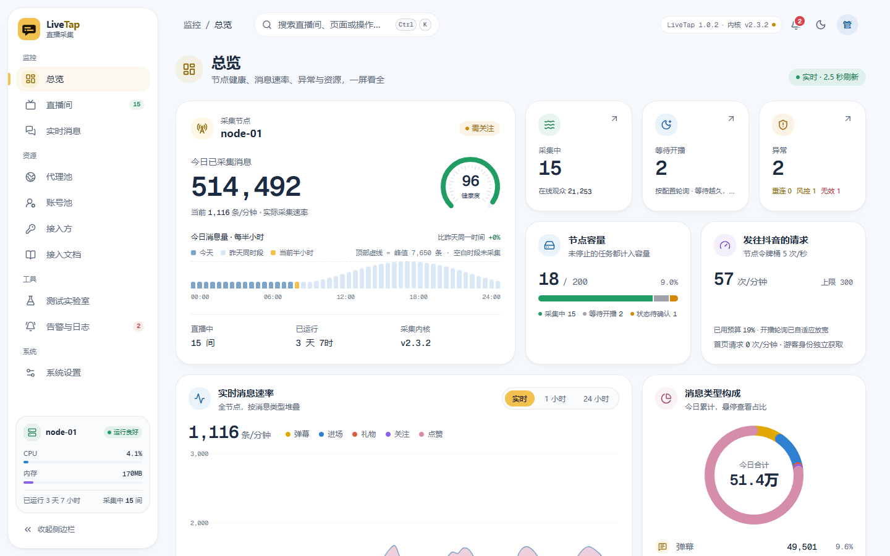
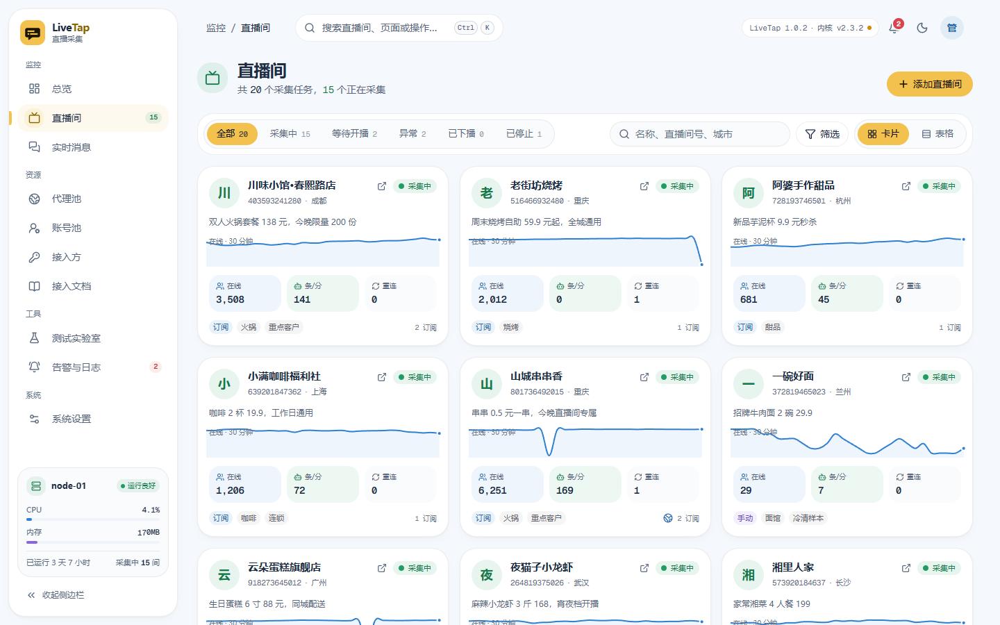
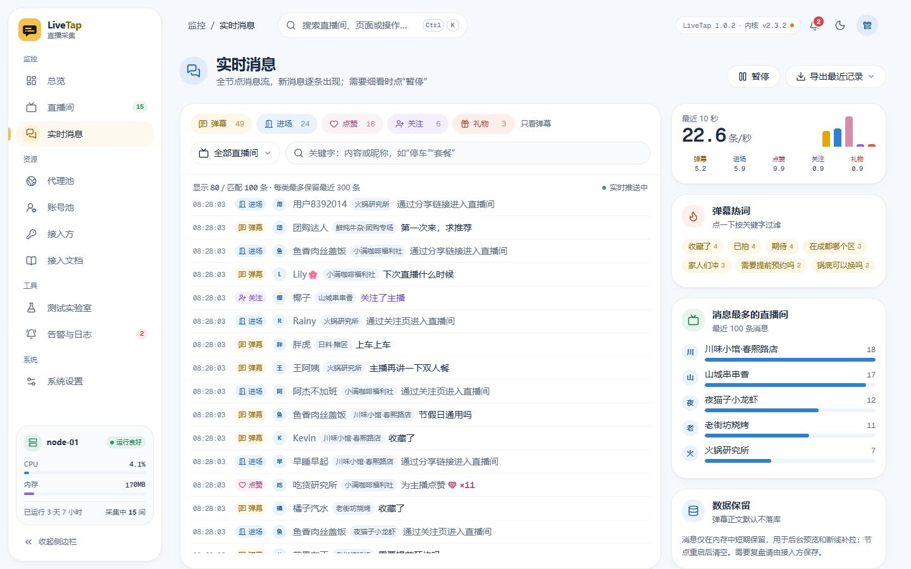
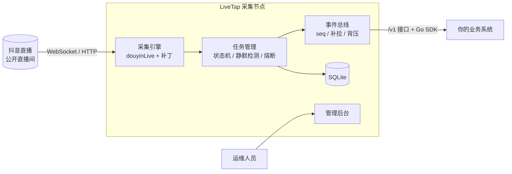

<div align="center">


# LiveTap

**抖音直播弹幕采集节点**

以观众身份只读接收公开直播间的弹幕、进场、礼物、关注等消息，<br/>
通过标准的 HTTP + WebSocket 接口实时推送给你的业务系统，自带完整的图形化管理后台。

[](https://github.com/Vz7797/LiveTap/actions/workflows/ci.yml)


[](LICENSE)

简体中文 | [English](README.en.md)

[基于 douyinLive](#基于-douyinlive) · [快速开始](#快速开始) · [接入](#接入) · [文档](#文档) · [常见问题](#常见问题) · [更新日志](CHANGELOG.md)

</div>

---

## 简介

很多直播业务都要实时读取直播间里的观众消息：AI 助播要根据弹幕回复，互动玩法要统计关注和礼物，数据看板要记录进场和在线人数。LiveTap 把“连接抖音、接收消息”这件事做成一个独立部署的采集节点：

- **业务系统只管业务**：调用北向接口订阅直播间，从一条 WebSocket 连接里收到统一格式的事件，不用关心抖音的私有协议、签名和重连。
- **节点只管采集**：每个直播间是独立的任务和状态机，开播、下播、断线、受限都有明确的状态和事件。
- **按需横向扩容**：节点之间互不依赖，业务量增长时多部署几个节点即可，房间怎么分配由业务系统决定。

## 基于 douyinLive

LiveTap 的采集内核来自 [jwwsjlm/douyinLive](https://github.com/jwwsjlm/douyinLive)（MIT 许可），固定在 v2.3.2，放在 [third_party/douyinLive](third_party/douyinLive)。

**对内核的修改**（补丁见 [deploy/patches](deploy/patches)，可以用 `node deploy/verify-engine.mjs` 离线核对）：

- 增加 HTTP 请求、响应和 WebSocket 握手的钩子，用于节点的请求预算，以及识别验证页和受限响应。
- 增加可选的游客身份接口，同一出口的多个直播间可以共用一份游客 Cookie。
- 查询房间信息时先用不签名的 web/enter 接口，直播页和带签名的接口改为兜底，减少被要求验证的情况。

**在内核之外新增的**：多直播间的任务管理与状态机、静默检测与受限熔断、北向接口与 Go SDK、管理后台、代理池与小号池、测试实验室、告警与日志。

## 截图

<picture>
  <source media="(prefers-color-scheme: dark)" srcset="docs/images/overview-dark.png" />
  
</picture>

<table>
  <tr>
    <td width="50%">
      <picture>
        <source media="(prefers-color-scheme: dark)" srcset="docs/images/rooms-dark.png" />
        
      </picture>
    </td>
    <td width="50%">
      <picture>
        <source media="(prefers-color-scheme: dark)" srcset="docs/images/messages-dark.png" />
        
      </picture>
    </td>
  </tr>
  <tr>
    <td align="center">直播间</td>
    <td align="center">实时消息</td>
  </tr>
</table>

<sub>截图使用内置的演示数据，店铺名称和消息均为虚构。</sub>

## 特性

**稳定采集**

- 每个直播间独立的任务与状态机：单间改配置只重建这一间，不影响其他房间。
- 自适应静默检测加旁证连接，不把“直播间冷清”误判成“连接断了”。
- 下播自动识别：10 分钟内没有重新开播就停止检测、释放资源，并通知订阅方。

**对上游克制**

- 节点级请求预算与启动限速，避免短时间内大量请求。
- 只有明确的验证页或拒绝访问才触发全节点冷却，冷却期间暂停新的探测和建连。
- 只读：不发弹幕、不点赞、不处理验证码。

**面向接入方**

- `/v1` 北向接口：订阅租约、多个接入方共享同一个上游连接、按 `seq` 断线补拉、明确的缺口通知、有界背压。
- 订阅状态心跳：随时知道每个房间是在采集、等待开播、已下播还是暂时受限。
- 附带 Go SDK：自动重连、自动续租、单流去重。

**运维齐全**

- 图形化管理后台：总览、直播间、实时消息、代理池、小号池、接入方、告警与日志、系统设置，支持深色主题和手机访问。
- 测试实验室：按档位逐步加房间，对照匿名、代理、小号等组合，测出节点的真实容量。
- 告警规则与 Webhook、按大小轮转的日志、审计记录。

**安全默认**

- 管理员密码使用 argon2id，带 CSRF 防护和按来源 IP 的登录锁定。
- 代理、小号 Cookie、API Key 等敏感配置用 AES-256-GCM 加密保存，日志自动脱敏。
- 容器以非 root 用户运行，根文件系统只读，基于 distroless 镜像。

## 工作原理



一个节点就是一个容器：Go 后端加上内嵌的 React 管理后台，数据存在 SQLite 里，不依赖外部数据库。

## 实测参考

我们在一台 4 核 4 GB、15 Mbps 带宽的国内云服务器上，用匿名游客身份、不加代理和小号做过多轮长时间实测：

| 测试 | 时长 | 同时订阅 | 同时采集 | 收到事件 | 缺口 | 节点冷却（风控） | CPU / 内存 |
|---|---|---|---|---|---|---|---|
| 不重启长测 | 93 小时 | 100 | 约 80～90 间 | 6423 万条 | 0 | 0 次 | 约 0.3 核 / 约 0.5 GB |
| 下播判断长测 | 62 小时 | 100 | 中位 89 间 | 4678 万条 | 0 | 0 次 | 中位 0.27 核 / 497 MB |

带宽、风控、延迟和选机器的建议见 [实测参考](docs/benchmark.md)。

## 快速开始

### 用 Docker 部署（推荐）

需要 Docker 和 Docker Compose。

```bash
git clone https://github.com/Vz7797/LiveTap.git
cd LiveTap

# 主密钥：用来加密代理、小号和 API Key。请保存到密码管理器，丢失后已加密的数据无法恢复
export LIVETAP_SECRET_KEY="$(openssl rand -base64 32)"
# 管理员初始密码（至少 12 位），首次登录后会要求修改
read -rsp "管理员初始密码: " LIVETAP_ADMIN_INITIAL_PASSWORD && export LIVETAP_ADMIN_INITIAL_PASSWORD

docker compose -f deploy/compose.yaml up -d --build
```

打开 <http://127.0.0.1:8090>，用户名 `admin`。默认只监听本机，要从其他机器访问，请放在 HTTPS 反向代理后面，见 [部署指南](docs/deployment.md)。

### 直接运行程序包

[Releases](https://github.com/Vz7797/LiveTap/releases) 里有 Linux（amd64 / arm64）、Windows（amd64）和 macOS（arm64）的程序包，解压后就是一个可执行文件，不需要安装别的东西。它是一个后台服务，没有图形界面：要先设置主密钥再启动，启动后在浏览器里打开管理后台。

Windows（在程序所在文件夹打开 PowerShell）：

```powershell
# 主密钥：第一次运行时生成，保存到密码管理器，以后每次启动都要用同一个
$bytes = New-Object byte[] 32; [Security.Cryptography.RandomNumberGenerator]::Create().GetBytes($bytes)
$env:LIVETAP_SECRET_KEY = [Convert]::ToBase64String($bytes)
# 管理员初始密码（至少 12 位），只有第一次启动需要
$env:LIVETAP_ADMIN_INITIAL_PASSWORD = Read-Host "管理员初始密码"
$env:LIVETAP_DATA_DIR = "$PWD\data"
$env:LIVETAP_LISTEN = "127.0.0.1:8090"
.\livetap.exe
```

Linux / macOS：

```bash
export LIVETAP_SECRET_KEY="$(openssl rand -base64 32)"   # 第一次生成后保存好，以后每次都用它
read -rsp "管理员初始密码: " LIVETAP_ADMIN_INITIAL_PASSWORD && export LIVETAP_ADMIN_INITIAL_PASSWORD
export LIVETAP_DATA_DIR="$PWD/data" LIVETAP_LISTEN=127.0.0.1:8090
./livetap
```

然后打开 <http://127.0.0.1:8090>，用户名 `admin`。数据库和日志在 `LIVETAP_DATA_DIR` 指定的目录里；不设置时默认是 `/data`，在 Windows 上就是当前盘根目录下的 `\data`。以后再启动时只需设置同一个 `LIVETAP_SECRET_KEY`、`LIVETAP_DATA_DIR` 和 `LIVETAP_LISTEN`。启动失败时，程序会直接在窗口里说明缺了什么。

### 从源码构建

需要 Go 1.27、Node.js 24 和 pnpm。

```bash
pnpm --dir web install --frozen-lockfile
pnpm --dir web build
go -C server build -o ../bin/collector ./cmd/collector
```

前端构建产物会被嵌入后端程序，最终只有一个可执行文件。开发、测试和内核补丁的维护方法见 [开发指南](docs/development.md)。

## 接入

1. 在管理后台的“接入方”页面创建一个 API Key（只显示一次）。
2. 调用北向接口订阅直播间，再连上 WebSocket 事件流接收消息。

| 接口 | 用途 |
|---|---|
| `GET /v1/node` | 节点信息、容量与健康状况，用来选节点 |
| `POST /v1/subscriptions` | 订阅一个直播间，可只订需要的消息类型 |
| `POST /v1/subscriptions:renew` | 续租（事件流在线时会自动续） |
| `POST /v1/rooms/status:batch` | 批量查询房间状态 |
| `GET /v1/stream` | WebSocket 事件流：消息、状态心跳、缺口与补拉 |

Go 项目可以直接使用 SDK：

```bash
go get github.com/Vz7797/LiveTap/sdk/go
```

```go
c, _ := collector.New(nodeURL, apiKey)
sub, _ := c.Subscribe(ctx, collector.SubscribeRequest{LiveID: "123456789", EventTypes: []string{"chat", "member"}})
go c.AutoRenew(ctx, []collector.Subscription{sub}, nil)
_ = c.Stream(ctx, collector.StreamOptions{
    OnEvent: func(e collector.Event) error { fmt.Println(e.Type, e.Seq); return nil },
    OnGap:   func(collector.Event) { /* 按业务需要处理缺口 */ },
})
```

完整示例见 [sdk/go/examples/minimal](sdk/go/examples/minimal/main.go)。接入前建议先读 [接入方开发指南](docs/integration-guide.md)：选节点、换节点、下播宽限、去重这些问题都有现成的做法。

## 配置

常用环境变量：

| 变量 | 默认值 | 说明 |
|---|---|---|
| `LIVETAP_SECRET_KEY` | 必填 | 32 字节随机值的 Base64，用来加密敏感配置 |
| `LIVETAP_ADMIN_INITIAL_PASSWORD` | 首次必填 | 管理员初始密码，至少 12 位 |
| `LIVETAP_LISTEN` | `0.0.0.0:8090` | 主监听地址 |
| `LIVETAP_DATA_DIR` | `/data` | 数据库和日志目录 |
| `LIVETAP_ADMIN_LISTEN` | 空 | 管理后台单独监听，建议只绑定内网 |
| `LIVETAP_NODE_NAME` | `collector-01` | 节点名称 |
| `LIVETAP_COOKIE_SECURE` | `false` | 位于 HTTPS 反向代理之后时设为 `true` |
| `LIVETAP_TRUSTED_PROXIES` | 空 | 反向代理的网段，逗号分隔 |
| `LIVETAP_LAB_ENABLED` | `false` | 是否开启测试实验室，正式环境保持关闭 |

完整列表见 [部署指南](docs/deployment.md#环境变量)。代理、小号、容量、限速等运行参数都在管理后台里设置。

## 文档

| 文档 | 内容 |
|---|---|
| [部署指南](docs/deployment.md) | Docker、环境变量、反向代理、备份与升级 |
| [接入方开发指南](docs/integration-guide.md) | 业务系统如何接入：选节点、换节点、消息筛选、下播宽限、去重 |
| [接口文档](docs/api.md) | 管理接口与北向接口：请求、响应、错误码、事件格式、补拉规则 |
| [实测参考](docs/benchmark.md) | 测试机器配置、容量、带宽、风控与延迟 |
| [设计文档](docs/design.md) | 架构、状态机、静默检测、请求预算、数据保留 |
| [开发指南](docs/development.md) | 构建、本机运行、测试、内核补丁维护 |
| [界面规范](docs/ui-guide.md) | 配色、排版、动效与性能预算 |

## 常见问题

<details>
<summary><b>需要登录抖音账号吗？</b></summary>

不需要。节点以游客身份连接公开直播间，只读接收消息。小号是可选项，只在测试表明匿名访问受限时才考虑使用，而且只建议使用专用小号，不要用商家主账号。
</details>

<details>
<summary><b>一个节点能采集多少个直播间？</b></summary>

默认容量上限是 200 间，可以在后台调整。实际能稳定采集多少，和服务器出口 IP、直播间热度都有关，建议用后台的“测试实验室”在自己的服务器上实测后再定。
</details>

<details>
<summary><b>会被抖音限制吗？</b></summary>

机房 IP 在短时间内大量请求时，可能会被要求验证。LiveTap 内置了请求预算、启动限速和全节点冷却，尽量避免触发限制；一旦触发，会暂停新的请求，等待恢复，不会尝试绕过验证。
</details>

<details>
<summary><b>弹幕会存下来吗？</b></summary>

不会长期保存。消息正文只在内存里为每个直播间保留最近一小段，用于后台预览和断线补拉；数据库里只存逐分钟的统计数字。需要留存消息的话，请在业务系统一侧保存。
</details>

<details>
<summary><b>支持快手、TikTok 等其他平台吗？</b></summary>

目前只支持抖音直播。采集引擎是可替换的设计，后续可以接入其他引擎。
</details>

## 免责声明

LiveTap 只读接收公开直播间里任何观众都能看到的消息，不发送内容、不点赞、不破解验证码，也不绕过平台的任何安全机制。使用者应自行遵守抖音的用户协议及所在地的法律法规，合理控制采集规模，并妥善处理采集到的数据。因使用本项目产生的任何后果由使用者自行承担。

## 参与开发

欢迎公开提交 Issue、改进建议和 Pull Request，一起把 LiveTap 做好；开发流程和提交规范见 [CONTRIBUTING.md](CONTRIBUTING.md)。

唯一的例外是安全漏洞：请先按 [SECURITY.md](SECURITY.md) 私下报告，避免在修复前让已部署的节点暴露在风险中；修复版本发布后，会在版本说明里公开问题和修复方式。

## 致谢

- [jwwsjlm/douyinLive](https://github.com/jwwsjlm/douyinLive)：采集内核，以固定版本加补丁的方式放在 [third_party/douyinLive](third_party/douyinLive)（MIT 许可）。
- [shadcn/ui](https://ui.shadcn.com/) 与 [beUI](https://beui.dev)：管理后台的组件基础（MIT 许可）。

完整的第三方组件及许可见 [THIRD_PARTY_NOTICES.md](THIRD_PARTY_NOTICES.md)。

## 许可

本项目采用 [MIT 许可](LICENSE)。第三方组件仍适用各自的许可，见 [THIRD_PARTY_NOTICES.md](THIRD_PARTY_NOTICES.md)。
