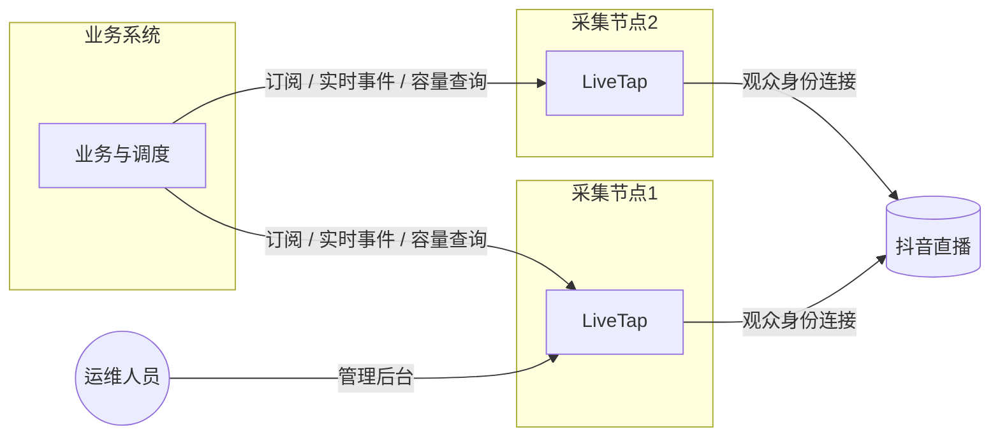
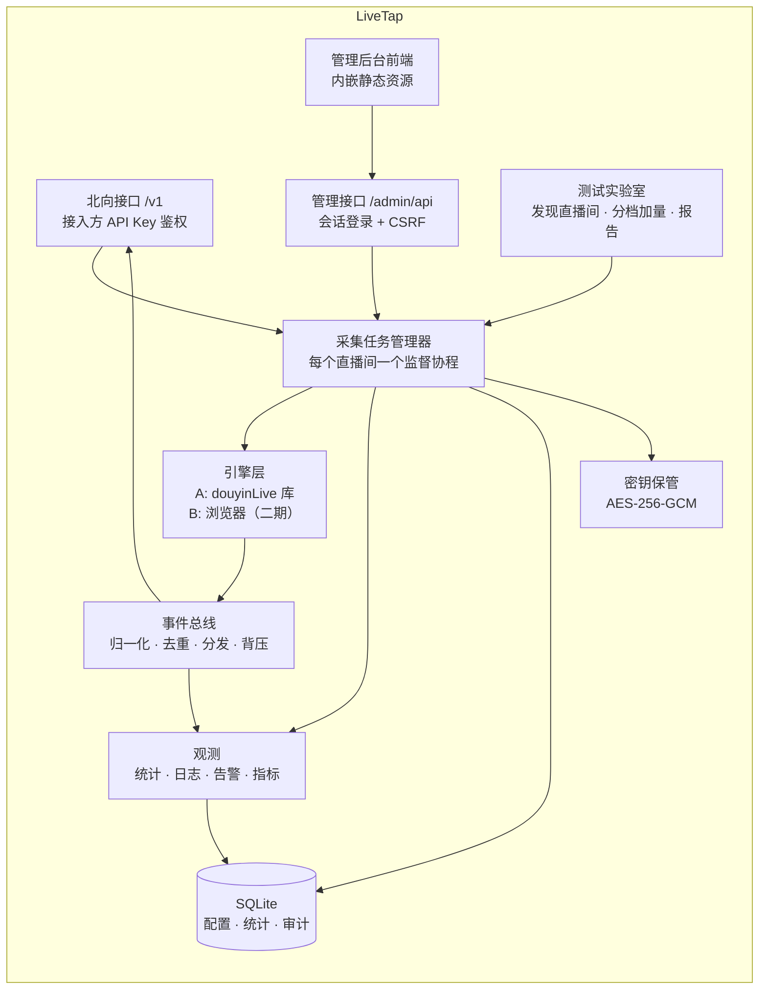
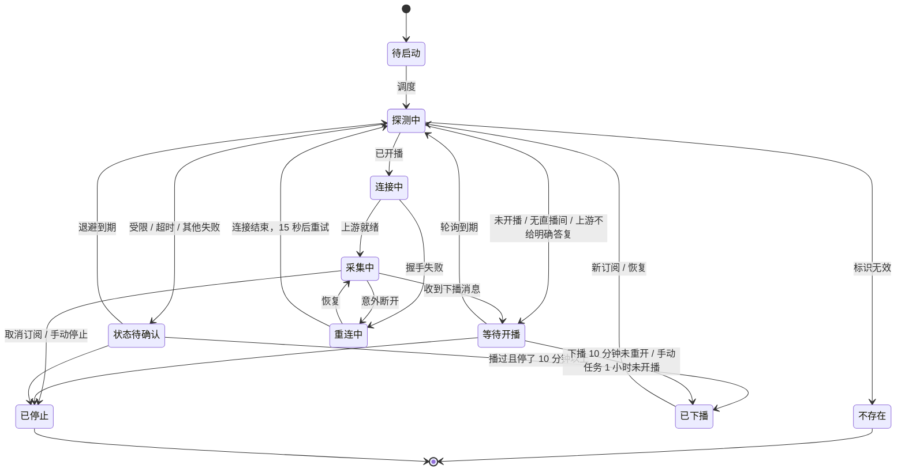

# LiveTap 设计文档

本文是 LiveTap 的设计依据：架构、采集任务与状态机、静默检测、请求预算、接口与数据、管理后台、测试实验室与部署。接口细节见 [api.md](api.md)，接入方实践见 [integration-guide.md](integration-guide.md)。

---

## 1. 背景与目标

### 1.1 背景

很多直播业务需要实时读取抖音直播间的观众弹幕、进场、关注等消息，例如 AI 助播、互动玩法、数据看板。LiveTap 把“连接抖音、接收消息”这件事做成独立的采集节点：

- **业务系统**（接入方）：负责自己的业务逻辑，以及把直播间分配给各个节点。
- **采集节点**（本服务）：只占少量 CPU 与网络，按需横向扩容。

两者只通过北向接口对接、相互隔离。业务量增长时，多部署几个节点并在业务系统里登记即可，节点之间不需要互相知道。

### 1.2 前期结论（本设计的输入）

| 结论 | 依据 |
|---|---|
| 采集走“旁观者”路线（以观众身份接收直播间公开消息），不走商家后台授权 | 不需要主播授权，适用于任何公开直播间 |
| 采集内核选用开源项目 douyinLive（Go，MIT，固定在 v2.3.2） | 对比 DyHub、DouyinLiveWebFetcher 等，它最成熟：单进程多房间、自动重连、持续维护 |
| 弹幕通道无需登录，但必须携带游客 Cookie `ttwid` | 2026-10-16 实测：不带被拒，只带 ttwid 即可连上 |
| 纯网页在商家手机上直连采集不可行 | 实测 iPhone 打开抖音网页会跳转 App，跨站 Cookie 带不上 |
| 本机实测资源占用很低 | 10 个直播间约 125 MB 内存，CPU 不到单核 2%，数据约 6 KB/s/房间 |
| 机房 IP 存在风控风险，需服务器实测确定容量 | douyinLive issue #66：Linux 服务器匿名请求触发风控 |
| 抖音协议每年有数次变动 | 公开问题记录显示每年约 2～4 次明显故障，每次影响数小时至数天 |

### 1.3 目标

1. **稳定采集**：单节点同时采集多个直播间，单个直播间的故障、重连、改配置都不影响其他直播间。
2. **全图形化运维**：douyinLive 的全部可调项及本服务新增能力都能在管理后台操作，不需要改文件、敲命令或借助 AI 调接口。
3. **标准接入**：为业务系统提供鉴权、订阅、实时推送和容量查询接口，输出统一的事件格式，屏蔽抖音私有协议。
4. **可观测、可诊断**：实时掌握每个直播间的状态、消息量、重连和风控情况，异常能第一时间发现。
5. **内置测试工具**：在后台一键完成服务器容量与风控测试，产出可留存的报告。
6. **为备用引擎留好位置**：内核可替换，后续能接入浏览器引擎，应对签名或接口突变。

### 1.4 非目标（本期不做）

- 不发送弹幕、不点赞、不做任何写操作，只读。
- 不自动破解验证码，不做规避平台安全机制的对抗。
- 不长期保存弹幕正文（见第 9 节数据保留策略）。
- 不做多节点之间的协调，调度由接入方负责。
- 浏览器引擎放到第二阶段。

---

## 2. 术语

| 术语 | 含义 |
|---|---|
| 节点 | 一个运行中的采集服务实例，通常对应一台服务器 |
| 直播间标识 `live_id` | 即 `live.douyin.com/` 后面的数字（web_rid），也支持抖音号短号 |
| 房间号 `room_id` | 抖音内部的直播场次 ID，每次开播都会变化 |
| 引擎 | 实际连接抖音、接收消息的模块。A 引擎为 douyinLive，B 引擎为浏览器（第二阶段） |
| 采集任务 | 节点上对某个直播间的一项持续采集，包含配置和运行状态 |
| 接入方 | 调用本服务接口的业务系统 |
| 订阅 | 接入方声明“我需要某个直播间的消息”，本服务据此创建或复用采集任务 |
| 风控 | 抖音对异常访问的限制：验证页、空响应、拒绝连接等 |

---

## 3. 总体架构

### 3.1 服务关系



业务系统按各节点的容量和健康度分配直播间。节点故障时，由业务系统把该节点上的订阅迁到其他节点。

接入方建议见 [integration-guide.md](integration-guide.md)：登记与巡检多个节点，按健康、非冷却、剩余容量分配，同房间尽量固定节点。自动静默迁移应仅针对最新状态为 `collecting` 且超过阈值未收到任何房间事件（含心跳）的房间；等待开播、探测中、节点冷却时不因没有弹幕迁移。AI 事件合并/限频、提问优先、过期任务放弃、下播宽限和跨节点持久去重由接入方决定具体实现。频繁迁移会增加上游探测和建连请求。

### 3.2 节点内部结构



### 3.3 技术选型

| 层 | 选型 | 理由 |
|---|---|---|
| 语言 | Go 1.27 | douyinLive 是 Go 库，可直接引用；单文件部署、资源占用低 |
| 采集内核 | `github.com/jwwsjlm/douyinLive/v2` v2.3.2（固定版本） | 每个实例可单独设置代理、Cookie、签名方式、协议画像 |
| 消息定义 | `github.com/jwwsjlm/douyinlive-proto`（MIT） | 两个引擎共用同一套消息解码，输出格式一致 |
| HTTP | 标准库 `net/http`（Go 1.22+ 路由） | 依赖少 |
| WebSocket | `github.com/coder/websocket` | API 简洁，支持 context |
| 存储 | SQLite（`modernc.org/sqlite`，纯 Go，无需 CGO） | 单节点、单文件，便于备份迁移；开启 WAL |
| 前端 | React 19 + Vite + TypeScript + Tailwind CSS v4 + shadcn/ui + Motion + beUI 组件 + Lucide 图标 | 视觉自由度高、动效能力强，详见第 11 节 |
| 前端数据 | TanStack Query + 原生 WebSocket | 缓存与实时推送 |
| 打包 | 前端构建产物用 `go:embed` 嵌入，单个二进制 | 部署只有一个程序 |
| 部署 | Docker 多阶段构建，运行镜像约 50～60 MB（实测引用 douyinLive 后的程序约 57 MB，主要是内置签名脚本引擎） | 与正式环境一致 |

---

## 4. 采集引擎

### 4.1 引擎抽象

为后续接入浏览器引擎，引擎统一实现以下接口：

```go
type Engine interface {
    Name() string                              // "douyinlive" / "browser"
    Probe(ctx context.Context, spec RoomSpec) (LiveStatus, error)
    Run(ctx context.Context, spec RoomSpec, sink Sink) error // 阻塞到直播结束、ctx 取消或不可恢复错误
}

type Sink interface {
    Event(e RawEvent)           // 解码后的直播消息
    State(s EngineState)        // 连接中 / 已就绪 / 重连中 / 已结束 / 失败
}

type RoomSpec struct {
    LiveID       string
    ProxyURL     string // 空 = 不走代理
    Cookie       string // 空 = 游客；由密钥保管模块临时解密注入
    SignProvider string // local / tikhub
    TikHubToken  string
    ProtocolMode string // web / pc
}
```

### 4.2 A 引擎：douyinLive

- 每个采集任务创建一个 `NewDouyinLiveWithOptions` 实例，传入该直播间的代理、Cookie、签名方式和协议画像。**实例之间互不影响**：改某个直播间的设置，只需释放旧实例、创建新实例，其他直播间不受影响。
- `Start()` 会阻塞，放在独立协程中运行。连接建立后 `Ready()` 通道关闭；直播结束、主动 `Close()` 或出现不可恢复错误时返回。
- 断线重连由 douyinLive 内部完成：1.5 秒起，指数退避，最长 60 秒，叠加最多 1.2 秒随机抖动；匿名探测连续失败 3 次会自动更换浏览器画像。
- 消息通过 `SubscribeMessage` 订阅，得到 `LiveMessage`（含原始 protobuf、已解析消息、直播间元信息、接收时间）。
- **重连与风控的观测**：库没有对外暴露重连事件。本服务为每个实例注入自定义 `slog.Handler`，从结构化日志中识别“准备重连”“握手失败”“上游已就绪”“上游可能限制匿名访问”等事件，转成统计与状态。这依赖日志文案，升级 douyinLive 时需回归测试（列入第 14 节升级检查清单）。
- **版本固定**：`go.mod` 锁定具体版本。升级流程见第 13.3 节。
- **补丁与固定副本**：将 v2.3.2 基线 `3b0c44876c2a9221cb11d27041af83720b9210c5` 的跟踪文件及补丁纳入 `third_party/douyinLive/`，保留 `LICENSE`、`ORIGIN.md`。`server/go.mod` 使用相对 `replace`，不再使用 `go.work` 或外部工作区。`Options.BeforeRequest` 覆盖 HTTP 跳转、重建和 WS 握手；`AfterResponse` 覆盖响应识别；可选 `GuestTTWID` 提供共享身份接口。
- **离线可复现校验**：补丁位于 `deploy/patches/douyinlive-v2.3.2-http-hook.patch`，原始 103 文件的 SHA-256 清单位于同目录 `douyinlive-v2.3.2-baseline.json`。`deploy/prepare-engine.ps1` 在临时副本中反向应用补丁，核对文件集合及哈希，不修改内核、不访问网络、不提交 Git。
- **消息解码契约**：内核普通消息的 `Parsed` 为空，节点在房间队列的消费协程中根据 `Method` 解码原始 protobuf；回调仅登记任意消息时间并尝试入队。
- **游客身份的获取**：共享开关默认关闭，保持内核每次匿名准备请求时访问首页的原行为。开启后使用第 5.5 节的内存身份缓存；已配置 Cookie 的任务优先使用其配置，完全跳过共享身份。
- **实例复用**：`Close()` 之后的实例不能再次 `Start()`。等待开播期间复用探测实例，确认开播后创建采集实例；仅复用实例不会减少默认游客模式的首页请求，需开启共享身份才可复用有效 `ttwid`。

### 4.3 B 引擎：浏览器（第二阶段）

- 用 Go 的 CDP 客户端控制无界面 Chrome 打开直播间页面，订阅 `Network.webSocketFrameReceived` 截获数据帧，再用 `douyinlive-proto` 解码。
- 优点：签名和接口由页面自己处理，**抗签名、接口变动**。
- 局限：资源消耗大（每个直播间约 100～200 MB）；**同样受 IP 风控影响**；消息格式变化同样需要更新消息定义。
- 定位为应急备用：按直播间手动切换，或配置为“A 引擎连续失败 N 次后自动切换”。运行镜像分为带 Chrome 与不带 Chrome 两种。

---

## 5. 采集任务与生命周期

### 5.1 任务来源

| 来源 | 说明 |
|---|---|
| 接入方订阅 | 业务系统调用订阅接口；同一直播间被多个接入方订阅时共享一个采集任务，引用计数归零后按保留时间释放 |
| 后台手动添加 | 运维人员在后台添加，用于测试或长期值守，标记为“手动”，不会被自动释放 |
| 测试实验室 | 压测时批量添加，测试结束自动清理 |

**直播间标识规范化**：同一个直播间可能以直播间号（web_rid）、抖音号短号或链接等不同形式传入。首次探测时统一解析为 web_rid，作为采集任务的唯一键，避免同一直播间被重复采集。接口和后台都接受这几种形式，但内部和事件中统一使用 web_rid。

**订阅租约**：接入方的订阅带租约（默认 120 秒）。只要该接入方的事件推送连接在线，租约自动续期；也可以调用续期接口续期。租约过期后自动取消订阅。这样在接入方把直播间迁到其他节点、或接入方自身异常退出时，不会在本节点留下无人使用的采集任务，白白占用容量、增加风控风险。

**长时间未开播自动释放**：订阅来源的任务连续“等待开播”超过 `idle_release`（默认 60 分钟）后自动释放，并推送 `status` 事件通知接入方。

**下播即停止检测**：典型用法是一场直播对应一次订阅。任务本次采集过、下播后 10 分钟内未重开，就进入“已下播”（`ended`）：不再向抖音发请求、不占容量，订阅以 `live_ended` 结束；手动/测试任务 1 小时内从未开播同样停止。停止状态持久化，重启后不恢复探测；新订阅、`resume` 或 `reconnect` 重新开始检测，管理员暂停的任务仍保持暂停。手动任务停止检测且 30 天未开播时自动删除。

具体约定：

- 每个接入方对同一规范化 `web_rid` 只有一条订阅。相同参数重复创建返回同一 ID 并续租；`external_ref`、事件类型或租约参数不同则返回 `subscription_conflict`，需先退订再订阅。
- `options.lease_seconds` 默认 120（1～3600）；`options.idle_release_seconds` 默认 3600（1～86400）。短时值用于离线测试，正常接入沿用默认。各订阅分别到期；最后一条引用取消后立即释放自动任务，当前保留时间为 0。等待期间的轮询不重置等待计时。
- WS 成功收到 Pong 才续租，单订阅流只续该条，全订阅流续该接入方全部有效租约；关闭流后仍可 HTTP 续租。HTTP 续租逐条处理，已结束的 ID 在响应里说明原因，不影响其余。每秒清理过期租约，到期后不能续活旧 ID；订阅结束时不在线的接入方，带游标重连后收到补发的 `subscription_released`。重启只恢复仍有效的订阅，清除过期订阅与孤儿自动任务。
- 手动任务可被订阅，最后退订也保留；管理员把自动任务手动添加后取得手动所有权。订阅不会恢复管理员暂停的手动任务。
- 数字 web_rid 与 `live.douyin.com` 完整链接可本地规范化；短号需固定上游地址确认 web_rid，走现有请求预算与冷却。无法确认返回 `upstream_unverified`；`v.douyin.com` 分享短链需先换成完整直播地址。

### 5.2 状态机

状态、分类（在播 / 异常 / 结束 / 占容量）和原因码统一定义在 `server/internal/model/roomstate.go`，后端各模块和管理后台（`web/src/lib/meta.ts`）都按它判断，测试会核对两边与[接口文档](api.md#状态与原因码)一致。每次状态变化都带一个稳定的原因码 `reason_code`，供程序判断。



| 状态 | 后台显示 | 说明 |
|---|---|---|
| 探测中 | 蓝 | 调用 `Probe` 确认是否开播 |
| 等待开播 | 青 | 按轮询间隔（默认 15 秒）检查是否开播 |
| 连接中 / 重连中 | 黄 | 由引擎内部处理；采集连接结束后，前 4 次每 15 秒重试，之后每 60 秒，持续采集满 2 分钟后重新计数 |
| 采集中 | 绿（静态圆点） | 正常接收消息 |
| 状态待确认 | 橙 | 节点受限、探测超时或其他探测失败；超时 15 秒后重试，其余指数退避，最长 5 分钟，并触发告警。之前在播过、已停了 10 分钟以上时（受限和超时除外）按已下播处理，不会一直停在这里 |
| 不存在 | 红 | 直播间标识无效，终止任务 |
| 已停止 | 灰 | 主动停止 |
| 已下播 | 灰 | 确认下播或长时间未开播后停止检测，不再发请求、不占容量 |

### 5.3 静默检测

“采集中”但长时间没有任何消息，可能是连上了却收不到推送（issue #66 的现象）；也可能只是直播间确实没人说话。为避免误判，**判断依据不是弹幕，而是抖音定时推送的系统消息**。

**实测依据（2026-10-16，本机，7 个直播中的房间，观察 150 秒）**：没人说话时，抖音仍会持续推送在线人数（RoomUserSeq）、直播间统计（RoomStats）、画面适配（RoomStreamAdaptation）、小时榜入口等系统消息。在线人数从 2 人到 1.5 万人的直播间，**任意两条消息之间的最大间隔为 2～19 秒**；只有 2 人在线的直播间，最大间隔也只有 15 秒。已下播的直播间不在“采集中”状态，不参与静默检测。

**规则**：

1. **只看“任何消息”，不看弹幕**：弹幕为零属于正常情况，绝不作为判断依据。
2. **自适应阈值**：每个直播间统计最近 30 分钟的消息间隔，阈值取 `max(90 秒, 间隔 P99 × 4)`，上限 300 秒。人少、消息稀疏的直播间，阈值会自动放宽。
3. **先确认，再动手**：超过阈值后先做两项旁证检查，再决定怎么处理：
   - 通过 HTTP 查询直播状态：已下播或上游不给明确答复，按正常下播处理（10 分钟内重开仍会接回）；探测失败，记为状态待确认。
   - 开一条临时旁证连接，持续 30 秒，看它能否收到系统消息。

   | 状态查询 | 旁证连接 | 判定 | 处理 |
   |---|---|---|---|
   | 已下播 | — | 正常下播 | 转入“等待开播” |
   | 在播 | 收到消息 | 主连接坏了 | 重建主连接 |
   | 在播 | 也收不到 | 直播间本身没有推送，或本 IP 被限制 | 不重建，标记“无数据”并提醒；连续出现时转“状态待确认” |
   | 无法确认 | — | 状态待确认 | 退避重试并告警 |

4. **重建有上限**：同一直播间 30 分钟内重建超过 3 次，不再自动重建，转为“状态待确认”并告警，避免反复重连加重风控。
5. **误判代价很小**：即使误判，代价也只是一次几秒钟的重连，不会丢失后续消息。
6. **节点冷却优先**：冷却中不发起静默旁证，不因旁证被冷却阻止而重建或关闭仍在采集的主连接。旁证过程中识别到受限时触发节点熔断，保留主连接。旁证期间主连接自行恢复消息时记一次“静默误判”；其他无法确定的情况不推算为误判。

**待验证**：0～1 人在线的极冷清直播间（例如刚开播的小团购店）是否仍有规律的系统消息推送。计划用自己的团购号开播实测；如果推送明显更稀疏，再调整阈值下限。

### 5.4 调度与节流

- 新任务启动时做全局限速（默认每秒最多启动 2 个），避免批量添加时集中请求抖音。
- 节点容量上限 `max_rooms`（默认 200，按服务器实测结果调整），统计所有未停止的任务（采集中、等待开播、状态待确认等），超过后拒绝新订阅。容量接口同时返回其中正在直播的数量。
- **节点受限熔断**：任一 HTTP / WS 握手出现验证页、403/429 或内核确认匿名访问受限时，暂停全节点新的探测、建连及内核重连请求。首次冷却 2 分钟，连续触发按 2、4、8、16、30 分钟退避，上限 30 分钟。同一冷却窗口内并发返回的受限响应合并一次，不重复翻倍或写告警；冷却结束后再连续 30 分钟未触发，退避档位重置。已建立的采集连接、消息接收与心跳保持运行；已发出的请求可能正常完成。等待支持取消，手动停止不必等冷却结束。
- 冷却为当前进程运行状态；总览展示剩余秒数，SQLite `incidents` 写入 `node_cooldown`，日志仅记录时长和档位；告警页保留完整历史，可开关规则并配置 Webhook。
- 冷却期间取得的启动或请求额度不保留至恢复时集中放行；到期后重新按启动限速与请求预算排队。

### 5.5 对抖音的请求预算

单个 IP 对抖音的请求频率是风控的重要依据，节点必须主动控制总请求量：

| 来源 | 控制方式 |
|---|---|
| 新任务启动（获取游客身份、查询直播间、建立连接） | 全局启动限速（见 5.4） |
| 等待开播的轮询 | 自适应：前 5 分钟每 15 秒一次，之后逐步放宽到 30 秒、60 秒，最长 120 秒；接入方通知“即将开播”时可立即探测一次 |
| 静默检测的旁证检查 | 全节点同时最多 3 个 |
| 探测失败后的重试 | 超时：固定 15 秒，连续 2 次超时更换探测实例；其他失败：指数退避，最长 5 分钟 |
| 采集连接结束后的重试 | 前 4 次每 15 秒，之后每 60 秒；持续采集满 2 分钟后重新计数 |
| 验证页 / 匿名访问受限 | 节点熔断优先，冷却期间不再发新请求；见 5.4 |
| 全局兜底 | 节点级令牌桶，限制每秒发往抖音的 HTTP 请求总数（默认 5 次/秒，后台可调） |

后台总览显示过去 60 秒的总请求数和首页请求数（仅 `live.douyin.com/`），被冷却取消、未真正放行的请求不计入；WS 握手计入总请求。每间同时提供累计请求数与过去 60 秒请求数，方便观察脚本取差值。

`share_guest_identity` 是节点开关，默认 `false`，位于系统设置“容量与限速”。开启后，同一代理出口与协议画像共用一份有效 `ttwid`，并发首取合并为一次；身份仍通过原内核的请求客户端获取，遵守相同限速与响应检查。首次实际获取的请求计到发起房间，总览另列首页总数。遵从上游有效期，未给有效期时缓存 30 分钟，最多缓存 6 小时。受限时清空内存缓存，等待节点冷却结束后按需重取。显式 Cookie 的任务始终独立，身份不写数据库、报告或日志。开关在下一次探测或重建时使用，不主动断开现有连接；效果等待真实对照测试后再决定默认值。

---

## 6. 配置模型

### 6.1 分层

```
内置默认值  →  节点全局默认（后台“系统设置”）  →  直播间单独设置（覆盖全局）
```

| 配置项 | 全局默认 | 按直播间覆盖 | 生效方式 |
|---|---|---|---|
| 代理（HTTP / SOCKS5，可带认证） | ✓ | ✓ | 重建该直播间连接 |
| Cookie（游客 / 小号登录态） | ✓ | ✓ | 重建该直播间连接 |
| 签名方式（本地 / TikHub）与 TikHub 密钥 | ✓ | ✓ | 重建该直播间连接（注意：TikHub 签名请求不走该直播间的代理） |
| 协议画像（web / pc） | ✓ | ✓ | 重建该直播间连接 |
| 引擎（A / B） | ✓ | ✓ | 重建该直播间连接 |
| 开播轮询间隔 | ✓ | ✓ | 下一次轮询生效 |
| 静默阈值 | ✓ | ✓ | 立即生效 |
| 推送的消息类型（弹幕、进场、点赞、关注、礼物、在线人数等） | ✓ | ✓ | 立即生效 |
| 容量上限、启动限速 | ✓ | — | 立即生效 |
| 共享游客身份 `share_guest_identity` | 节点开关，默认关闭 | — | 下一次探测或重建，不主动断连 |
| 数据保留天数 | ✓ | — | 下一次清理生效 |
| 监听地址、端口、数据目录、主密钥 | 环境变量 | — | 重启服务 |

### 6.2 全局默认变更的应用策略

修改全局默认时，后台询问应用方式：

1. **仅新任务**：已在运行的直播间保持原样，直到它们下一次重建连接。
2. **逐个滚动应用**：按设定间隔（默认 10 秒）逐个重建继承默认值的直播间，每次只影响一家几秒，进度在后台可见、可暂停。

单独设置过该项的直播间不受全局变更影响。

### 6.3 代理池与账号池

- **代理池**：登记多个代理，支持连通性和延迟测试、启用或停用、给直播间指定代理，或按策略自动分配（轮询 / 最少占用）。
- **账号池（小号 Cookie）**：登记小号 Cookie，**不使用商家直播账号**。支持有效性检测、指定或自动分配、单个小号的直播间上限（默认 5）。Cookie 加密存储，界面只显示脱敏片段。
- 默认游客模式；某个直播间出现风控时，可一键“为该直播间分配小号 / 代理”。
- 代理池与小号池：HTTP / SOCKS5 代理、小号增删改查及启停、标签、上限与手动检查；仅启用的代理每 30 分钟自动检查，小号不定时检查。代理认证与 Cookie 使用 AES-256-GCM 按资源 ID 绑定加密；后台输入隐藏，列表不返回原值；编辑时留空保留原凭据。账号新增须确认专用小号。
- 分配入口在资源池和单房间设置，可指定、轮询或最少占用；暂停房间也占资源分配名额，避免恢复后超额。明确失效后不再参与分配：代理解除绑定并暂停相关房间，小号解除绑定并退回游客。受限或无法确认不当作凭据过期；新资源“未确认”可由管理员分配，不等于真实检测通过。
- 检测和分类发现同样经过节点请求预算及冷却；冷却期间自动检查跳过。小号只在后台手动点击时检测，可选代理。检测复用内核固定版本的 req 库，使用同款 Windows Chrome 133 UA、TLS 及 HTTP/2 画像；直连启用 HTTP/3 与失败回退，代理关闭 HTTP/3，不继承宿主机代理，不跟随重定向。登录态只在上游明确返回用户身份时标记有效，空响应或接口变化标记未确认。当前检测适配依据上游自用户接口，真实可用性留待用户提供小号后验证；不自动注册账号或寻找代理。

---

## 7. 北向接口（供接入方调用）

### 7.1 鉴权

- 每个接入方一个 API Key，格式 `lt_live_` 加 32 字节随机数（Base62）。仅在创建时显示一次，库中只存 SHA-256 摘要。
- 请求头：`Authorization: Bearer <key>`。WebSocket 握手同样用请求头（接入方是服务端，不受浏览器限制）。
- 每个接入方可限制可用的直播间数量上限和来源 IP 白名单。
- 停用或删除立即撤销事件连接及订阅；改变来源 IP 网段会断开已有连接，下次握手重新检查。来源识别与后台共用 `LIVETAP_TRUSTED_PROXIES` 规则。成功请求和活跃 WS 共用最后使用时间，最多每 30 秒写库一次，显示精度也是 30 秒。
- 管理接口仅接受后台会话及写入 CSRF；北向接口仅接受 API Key。节点信息可以查看聚合容量，订阅、房间详情与事件只能查看本接入方拥有的部分。

### 7.2 接口列表

| 方法 | 路径 | 说明 |
|---|---|---|
| GET | `/v1/node` | 节点名称、版本、引擎、启动标识、健康度、容量（上限、已用、直播中）、负载分数、冷却状态 |
| POST | `/v1/subscriptions` | 订阅：`{live_id, external_ref, event_types[], options}`，返回订阅 ID 和当前状态；幂等（同一接入方 + `live_id` 返回同一订阅） |
| GET | `/v1/subscriptions` | 本接入方的全部订阅及状态 |
| GET | `/v1/subscriptions/{id}` | 单个订阅详情 |
| DELETE | `/v1/subscriptions/{id}` | 取消订阅 |
| POST | `/v1/subscriptions:renew` | 批量续期租约（推送连接在线时自动续期，一般不需要调用） |
| POST | `/v1/rooms/status:batch` | 查询自己订阅的规范化房间号/完整链接状态（最多 50 个），不另行探测上游 |
| GET | `/v1/stream` | WebSocket：推送本接入方全部订阅的事件（多路复用），也可用 `?subscription=` 只收一个 |

`external_ref` 由接入方传入（如“企业 ID + 场次 ID”），本服务原样附在事件中，方便接入方归属，本服务不解析其含义。

`/v1/node.api_version` 为独立接口契约版本，当前固定 `v1`；`version` 是采集服务软件版本。接入方启动和定时巡检时校验 `api_version`，不一致时告警并停止分配。Go 接入方可直接引用 `github.com/Vz7797/LiveTap/sdk/go`。

### 7.3 统一事件格式

```json
{
  "id": "7701234567890123456",
  "seq": 1048576,
  "type": "chat",
  "subscription_id": "sub_8f3k2",
  "external_ref": "t_102:s_88",
  "live_id": "403593241280",
  "room_id": "7696945466596018971",
  "ts": "2026-10-16T12:00:01.234Z",
  "received_at": "2026-10-16T12:00:01.310Z",
  "user": { "id": "1234567", "sec_uid": "MS4w...", "nickname": "小王", "avatar": "https://..." },
  "content": "这个套餐几点能用？",
  "extra": {}
}
```

| type | 来源消息 | 主要字段 |
|---|---|---|
| `chat` | WebcastChatMessage | user、content |
| `member` | WebcastMemberMessage | user（进入直播间） |
| `like` | WebcastLikeMessage | user、extra.count、extra.total |
| `social` | WebcastSocialMessage | user、extra.action（关注 / 分享） |
| `gift` | WebcastGiftMessage | user、extra.gift_name、extra.repeat_count（匿名模式下可能缺失） |
| `room_stats` | WebcastRoomUserSeqMessage | extra.online、extra.total_pv |
| `status` | 本服务生成 | extra.state（第 5.2 节状态）、extra.reason |

- **两个编号**：`id` 是抖音的消息 ID，全局唯一，用于去重（包括接入方在节点迁移期间收到重复消息时去重）；`seq` 是本节点生成的单调递增序号，用于断线补拉。
- **去重**：以 `id` 为键，每个直播间保留最近 10 分钟、最多 2000 条的内存记录；接入方跨重连/迁移/重启的幂等建议用 `(live_id,id)` 持久保存。
- **顺序**：同一直播间内按接收顺序推送，不保证跨直播间的全局顺序。
- **背压**：每个连接有发送队列上限（默认 2000 条或 4 MB）。超限时先丢弃点赞、在线人数这类低价值消息，再丢弃进场、礼物/关注等社交消息；弹幕最后才丢，状态不丢，并推送一条 `status` 事件说明丢弃数量。持续超限则断开连接，由接入方重连。
- **重连补拉**：接入方断线重连后携带 `?since_seq=`，补拉最近 60 秒、每个直播间最多 1500 条的内存缓存消息。超出缓存范围时推送一条 `status` 事件说明有缺口，由接入方自行决定是否忽略。节点重启后 `seq` 从新的起点开始，并在 `/v1/node` 中返回节点启动标识，接入方据此判断不能跨重启补拉。

推送细则（完整报文见 `docs/api.md`）：

- `id` 沿用上游消息 ID；本地产生的状态事件没有抖音 ID，使用空字符串，不伪造。`seq` 可因其他接入方或事件过滤而跳号，不能据此自行判定丢失。
- 重连同时带 `boot_id` 与 `since_seq`，仅补发订阅生效后的本接入方事件。省略 `since_seq` 只收后续事件；SDK 首次也带当前启动标识和 `since_seq=0`，补回订阅到连流之间的缓存。
- 每房补拉缓存还受 1 MiB 限制，静默房间也定时清理过期正文；单次重连最多补 20000 条或 32 MiB，避免跨大量房间积累无界缓存。超限发送 `gap`，允许后续业务选择继续，不宣称完整恢复。
- `status` 分两类：带顶层 `subscription_id` 的房间状态；不带该字段的连接控制帧（`hello`、`gap`、`backpressure`、`subscription_released`）。控制帧也有节点 seq，但客户端不得据此推进补拉游标；仅成功处理的订阅事件推进游标。启动标识改变或 `reset_cursor:true` 时重置游标。
- 发送队列为每连接 2000 条或 4 MiB，依次淘汰点赞/在线人数、进场、礼物/社交、弹幕，状态（含订阅心跳）不参与淘汰；合并通知普通事件丢弃数。无法容纳状态时立即断开慢连接，由接入方按已处理游标重连补拉，超出缓存明确提示 gap。连续 100 次溢出或单次网络写入超过 5 秒就断开；每接入方最多 8 个连接。采集回调和其他接入方不等待慢客户端网络写入。
- Go SDK 自动重连、续租、单流消息 ID 去重（每房 10 分钟/2000 条），显式 `OnGap` 回调；未提供缺口回调时返回 `GapError`。业务跨进程、跨节点的长期幂等由接入方保存消息 ID 完成。

#### 订阅状态心跳

- 每条有效订阅默认每 60 秒收到一条 `type=status`、`extra.code=heartbeat` 的房间事件；每秒检查到期时间，允许约一秒调度偏差。`LIVETAP_STATUS_HEARTBEAT_SECONDS` 可设 1～3600 秒，默认 60。生产建议保留默认，接入方静默阈值应大于数个心跳间隔并留余量。
- 心跳含当前 `state/reason`、`last_message_at`、`heartbeat_interval_seconds`、`node_cooldown`、`cooldown_remaining_seconds`。`last_message_at` 是本任务最近收到上游消息的时间（RFC3339），尚未收到时为 null；连接启动、状态变化和心跳均不更新它，任务重建/进程重启后重置。
- 节点冷却且任务启用、尚未采集时，心跳 `state=cooling`，`base_state` 保留原状态；已采集、已停止、不存在的房间保持原状态。节点冷却信息仍附带在心跳中。
- 同房间按一个周期采样和发布，由现有路由向每个有效订阅分别附加订阅 ID 与 external_ref；不会因订阅数增加而重复采样或增加上游请求。新增订阅沿用该房间周期，首次在一个间隔内收到；续租/幂等订阅不重置周期。无接收连接仍写入内存补拉缓存，退订/到期后停止该订阅心跳，最后引用清理定时记录。
- 心跳不受 event_types 过滤，走正常 seq、补拉、隔离和最高优先级背压；ID 为空，不伪造抖音消息。最高优先级不表示无限存储：无法容纳状态立即断开，缓存过期/超限或重启仍需明确 gap。
- 心跳不写入上游采集计数，不重置上游静默/等待开播计时，不续租，不访问抖音。它只说明“房间仍在管理”，不证明上游有新消息；与 WS Ping/Pong 不同。完整格式见 api.md。

### 7.5 引擎回调与内存预算

- **引擎回调绝不阻塞**：douyinLive 的消息回调里只做“放入该直播间的有界队列”（默认 1000 条），归一化、去重和分发都在独立协程中完成。队列满时按 7.3 的优先级丢弃，并计入统计。
- **单直播间内存预算**：本机实测约 6 MB/直播间（含 douyinLive 实例）。本服务额外的缓存（最近 200 条消息、去重记录、分钟统计）控制在 1 MB 以内。测试实验室记录每一档的内存，用于校准 `max_rooms`。

### 7.4 错误格式

```json
{ "ok": false, "error": { "code": "capacity_exceeded", "message": "节点容量已满", "suggestion": "请分配到其他节点" }, "request_id": "..." }
```

主要错误码：`unauthorized`、`forbidden`、`invalid_request`、`invalid_live_id`、`capacity_exceeded`、`subscription_conflict`、`not_found`、`rate_limited`、`upstream_unverified`、`internal_error`。越权资源统一视为不存在，响应不包含原始凭据、上游响应或底层错误。

---

## 8. 管理接口与后台权限

- 后台走 `/admin/api/*`，使用会话登录：HttpOnly + SameSite=Strict 的 Cookie、CSRF 令牌、登录失败限速与锁定。
- 首期为单管理员账号，密码使用 argon2id 哈希。首次启动从环境变量读取初始密码，登录后强制修改。
- 登录失败与改密时旧密码错误按来源 IP 合并计数，5 次失败锁该 IP 15 分钟，其他 IP 可继续登录；不再锁整个账号。LIVETAP_TRUSTED_PROXIES 默认空，以逗号分隔的 IPv4 / IPv6 CIDR 指定实际可信代理；非法配置拒绝启动。仅 TCP 对端可信时读取 X-Forwarded-For，从右向左跳过可信代理，取首个非可信地址（全链可信则取最左地址）；没有 XFF 时使用单个 X-Real-IP。格式错误、链条过长或对端不可信均退回 TCP 对端，IPv4 映射地址统一归一，避免伪造转发头绕过锁定。LIVETAP_COOKIE_SECURE 可强制设置 Secure，启动及每 15 分钟清理过期会话与失败计数。
- 所有写操作记入审计日志：谁、什么时间、改了什么（敏感值脱敏）。
- 管理接口覆盖：直播间增删改查与批量操作、代理池、账号池、接入方与 API Key、全局设置、日志查询、告警规则、测试实验室、节点信息。

---

## 9. 数据存储

### 9.1 主要数据表

| 表 | 内容 |
|---|---|
| `rooms` | 采集任务：live_id、来源（订阅 / 手动 / 测试）、单独设置（JSON）、备注、标签、创建时间 |
| `subscriptions` | 接入方、live_id、external_ref、消息类型、状态 |
| `clients` | 接入方：名称、Key 摘要、前缀、权限、额度、IP 白名单、启用状态 |
| `proxies` | 代理池：地址（密码加密）、标签、状态、最近测试结果 |
| `accounts` | 小号池：备注、Cookie（加密）、有效性、分配上限 |
| `settings` | 全局默认配置（键值） |
| `room_stats_minute` | 每直播间每分钟的统计：各类消息数、重连次数、静默时长、状态（保留 48 小时） |
| `room_stats_hour` | 超过 48 小时的分钟统计按小时汇总：各类消息数、重连次数、静默时长 |
| `incidents` | 风控、静默、失败等事件 |
| `audit_logs` | 后台写操作审计 |
| `lab_runs` / `lab_samples` | 测试实验室的批次与采样数据 |
| `admin` | 管理员账号与会话 |

### 9.2 数据保留

- **弹幕正文默认不落库**，只在内存中为每个直播间保留最近 200 条，用于后台预览和断线补拉。
- 逐分钟统计保留 48 小时（够总览“今日 / 昨日”使用），之后汇总为按小时统计，保留 30 天；事件、告警与审计保留 90 天（天数均可在后台调整）。告警页可手动确认、批量清理；日志文件按大小轮转，可导出和清理。
- 测试报告只保留最近 20 份（运行中的不删），可在测试实验室手动删除。采样中节点指标每 5 秒一条，每房间明细只在每分钟和每档结束时保存，并以 gzip 压缩存储。
- 每小时清理一次；数据库使用 `auto_vacuum=INCREMENTAL`，清理后增量回收空间，不再执行阻塞全部写入的整库 `VACUUM`。旧数据库在首次启动时转换一次。

### 9.3 敏感信息

- Cookie、代理密码、TikHub 密钥使用 AES-256-GCM 加密，主密钥来自环境变量 `LIVETAP_SECRET_KEY`，不进入数据库和日志。
- 界面与日志统一脱敏，例如 `ttwid=1%7C****Ab3f`。
- 备份数据库时，没有主密钥无法解密上述字段。

---

## 10. 可观测性

### 10.1 指标

- **节点**：CPU、内存、协程数、上行和下行流量、打开的连接数。
- **直播间**：状态、每分钟各类消息数、最近一条消息时间、重连次数、静默次数、使用的引擎、代理、账号。
- **接入方**：连接数、每秒推送量、丢弃量、队列水位。
- 总览与接入方页展示真实订阅数、连接数、推送速率、队列长度和丢弃数；节点北向流量为 WebSocket 成功发送的 JSON 字节数（含补拉和控制帧），速率按过去 60 秒平均。它不包含 HTTP、协议头或 TLS 开销，不等同于网卡流量。计数随进程重启清零。
- 对外提供 `/metrics`（Prometheus 格式，需要鉴权）和 `/healthz`（公开，供 Docker 健康检查）。

### 10.2 告警规则（默认）

| 规则 | 条件 | 级别 |
|---|---|---|
| 大面积失败 | 5 分钟内超过 30% 的直播间进入状态待确认或重连 | 严重 |
| 单直播间静默 | 采集中但超过自适应阈值无任何消息，且旁证检查确认异常（见 5.3） | 警告 |
| 风控升级 | 同一直播间 30 分钟内静默重建超过 3 次 | 警告 |
| 容量将满 | 已用超过上限的 85% | 提醒 |
| 代理或账号失效 | 检测明确失效并摘除 | 警告 |
| 节点受限冷却 | 验证页或匿名受限触发节点熔断 | 警告 |

告警在后台醒目展示，并可配置 Webhook 推送（例如经接收端转换后推给企业微信或业务系统）。告警保存在 SQLite，可筛选和确认；规则开关、30%/85% 阈值可配置。关闭冷却告警仅关闭通知，不关闭熔断。Webhook 地址加密保存、界面不回显，发送通用脱敏 JSON，5 秒超时、最多 3 次尝试，不自动跟随重定向。

### 10.3 日志

- 结构化 JSON 日志写入文件并按大小轮转；后台提供实时日志页（内存环形缓冲），支持按级别、直播间、关键字过滤。
- 敏感字段统一脱敏。日志同时输出到标准输出和数据目录 logs/collector.log；单份 10 MB，保留 5 个轮转备份。后台查内存最近 1000 条中的最多 100 条，不把文件历史冒充实时日志。只记录明确允许的结构化字段，上游原始错误、Cookie、代理认证和密钥不写入日志。
- 自由文本中的 Cookie / Set-Cookie 遮蔽完整值，直到行尾或引号边界；Authorization 同样完整遮蔽。凭据字段按名称前缀匹配，含 sid_tt、sessionid_ss、uid_tt、odin_tt、passport_*、msToken、s_v_web_id 及原有字段。脱敏后最多保留 1000 字节，在 UTF-8 完整字符处截断；文件、标准输出和后台内存查询使用同一脱敏结果。

---

## 11. 管理后台界面设计

### 11.1 设计方向

目标是一个**清新、大气、简约，一眼看懂且操作流畅**的运维后台。

- **参考**：TabTab Admin 的信息层级与 Bento 网格、beUI 的控件细节与操作反馈，收敛颜色与动画。
- **关键词**：清透底色、按用途点缀、留白有节奏、全宽左对齐、快速响应。
- **布局**：内容与顶栏铺满侧边栏右侧的可用宽度。桌面左右固定约 24 px 内边距，手机约 16 px；标题、筛选与操作按内容顺序左对齐。宽屏通过增加网格列数利用空间，不设置让整页居中的最大宽度。

技术沿用 Tailwind CSS、shadcn/ui、Motion 与 beUI；表格、表单使用现有基础组件和 TanStack Table。统一复用共享组件与设计令牌，具体字号、间距、响应式和性能规则见 `docs/ui-guide.md`。

### 11.2 视觉语言

**主题**：默认深色，同时提供浅色主题。默认精简动效下直接切换；标准模式可使用 220 ms 的点击位置扩散，系统“减少动态效果”开启时直接切换。

**底色与品牌色**：浅色使用云白与浅蓝底，深色使用蓝墨底与稍亮的蓝色卡片，减轻黑灰堆叠。品牌黄用于主按钮、当前选中态和少数关键数据（总览“今日节奏”的当前时段、最活跃直播间第一名、弹幕数据）。**克制靠“彩色用得少”，不靠把颜色调灰调脏**：用到的颜色保持干净、中等饱和，不发光。下表对应 `web/src/index.css` 中的令牌：

| 用途 | Token | 浅色主题 | 深色主题 |
|---|---|---|---|
| 页面底色 | `--background` | `#f5f8fc` | `#101724` |
| 正文 | `--foreground` / `--card-foreground` | `#1c2b42` | `#edf2fa` |
| 卡片底色 | `--card` | `#ffffff` | `#192234` |
| 浮层底色 | `--popover` / `--elevated` | `#ffffff` | `#202d43` |
| 控件基础底色 | `--muted` | `#eef4fa` | `#243249` |
| 次级文字 | `--muted-foreground` | `#58677c` | `#adbcd1` |
| 弱化说明与坐标 | `--faint-foreground` | `#66758a` | `#96a7be` |
| 次级按钮底色 | `--secondary` | `#eaf1f9` | `#26364e` |
| 悬停底色 | `--accent` | `#eaf2fc` | `#2a3b55` |
| 普通边框 | `--border` | `rgb(24 24 27 / 0.08)` | `rgb(255 255 255 / 0.07)` |
| 加强边框 | `--border-strong` | `rgb(24 24 27 / 0.15)` | `rgb(255 255 255 / 0.13)` |
| 品牌与主按钮底色 | `--primary` | `#f2c14e` | `#f2c14e` |
| 主按钮文字 | `--primary-foreground` | `#1a1404` | `#1a1404` |
| 键盘焦点描边 | `--ring` | `#e0a800` | `#f2c14e` |
| 普通数据图形（浅蓝） | `--c-graph` / `--c-bar` | `#7da4c9` / `rgb(47 128 208 / 0.18)` | `#7094bd` / `rgb(64 150 224 / 0.22)` |

**功能色**：图形使用 `--c-*`，文字使用 `--ink-*`；浅色主题的文字色加深，不直接用图形色显示小字。弹幕保持品牌黄，点赞改用柔和玫瑰色；CPU、内存、带宽等曲线按已有用途色显示。图例、标签和分隔线辅助识别，不能只靠颜色区分。

| 用途 | 图形 / 文字 Token | 浅色图形 | 浅色文字 | 深色图形 | 深色文字 |
|---|---|---|---|---|---|
| 弹幕 | `--c-chat` / `--ink-chat` | `#e0a800` | `#8a6400` | `#f2c14e` | `#f2c14e` |
| 进场 | `--c-member` / `--ink-member` | `#2f80d0` | `#1f63a8` | `#4096e0` | `#6aaeea` |
| 点赞（玫瑰） | `--c-like` / `--ink-like` | `#d58daa` | `#a3446c` | `#bd7f9b` | `#edb3cc` |
| 关注 / 分享 | `--c-social` / `--ink-social` | `#8a63e6` | `#6a49c9` | `#9a7cf0` | `#b09cf5` |
| 礼物 | `--c-gift` / `--ink-gift` | `#dc5a3c` | `#b8432a` | `#e0644a` | `#ee8a70` |
| 系统 / 信息 | `--c-info` / `--ink-info` | `#2f80d0` | `#1f63a8` | `#4096e0` | `#6aaeea` |
| 正常 / 采集中 | `--c-ok` / `--ink-ok` | `#1f9d63` | `#16794a` | `#3fb27f` | `#5cc596` |
| 警告 / 状态待确认 | `--c-warn` / `--ink-warn` | `#d48806` | `#a05f00` | `#e5a03a` | `#edb25a` |
| 失败 | `--c-err` / `--ink-err` | `#d9434b` | `#b8323a` | `#e5636b` | `#ee8088` |
| 已停止 / 中性曲线 | `--c-idle` / `--ink-idle` | `#a1a1aa` | `#63636d` | `#71717a` | `#a1a1aa` |

彩色集中在图标、标签和数据图形上，页面与卡片用清透的底色保持阅读层次。语义标签与图标底块使用浅色 10%、深色 14% 的同色透明底；图标底块默认按用途使用同色浅底，停用状态保留中性灰。堆叠图用“色带”画法：每层实色填充（浅色主题透明度 0.55 / 0.4，深色主题 0.76 / 0.6，深色底上透明度过低会发灰发脏），层间用卡片底色细线分隔，不画彩色描边。不添加光晕、彩色阴影、外发光、彩虹头像圈或大面积渐变；直播间迷你曲线按状态着色，采集中统一绿色，停用保留灰色。
**图形化元素**：

- 统计图标使用约 36 px 的同色浅底与对应文字色，颜色沿用卡片用途；不加光晕或彩色阴影。
- 状态使用“静态圆点 + 短标签”；头像使用浅蓝底与文字，在线头像用浅绿底，停用头像弱化，不随直播状态旋转。
- 消息类型标签按上表统一配色，颜色只表达对应消息类型或状态。
- 总览保留静态健康仪表、消息曲线与雷达信息；删除弹幕气泡流、扫描光晕和背景装饰动画。
- 直播间迷你曲线统一按状态着色，在线人数与消息速率统计分别用浅蓝与浅绿底，不按房间随机配色。
- 迷你图面积填充采用单色低透明度（8%），堆叠图沿用上面的色带规则；数据更新直接绘制，不补间。图标统一使用 Lucide，静态插画使用 SVG。
- 卡片与浮层使用纯色或半透明纯色，禁止 `backdrop-filter` / `backdrop-blur` 毛玻璃。
- 实时消息排行、接入方连接与额度使用蓝色，推送量使用绿色，丢弃与接近额度上限使用警告色；热词使用统一浅黄标签。实验室结论用纯色卡片、蓝色细边与关键数字，避免整块渐变。

**字体**：中文使用系统字体（苹方 / 微软雅黑）；数字统一使用等宽数字（Geist Mono），普通数字直接更新，保持可读且稳定。

### 11.3 动效原则

**默认精简**：系统设置提供“动效：精简 / 标准”，默认精简。操作系统开启“减少动态效果”时始终等同于精简，覆盖标准选择。标准模式也不启用常驻循环装饰。

| 场景 | 规则 |
|---|---|
| 页面静置、采集状态、背景与插画 | 保持静态，无呼吸光晕、扫描或无限循环装饰 |
| 点击、悬停、标签与面板操作 | 仅由用户操作触发，150～250 ms，使用简单缓动，不用弹簧回弹 |
| 数字变化 | 默认直接显示；只有少数关键数字显式开启动效，标准模式下每次数值变化执行一次，精简模式直接更新 |
| 实时消息流 | 直接插入有上限的列表，不做逐条进场、布局重排或模糊动画；保留悬停暂停、手动暂停与过滤 |
| 打开直播间详情 | 简单淡入与小幅位移；原卡片保留淡化占位，关闭后恢复 |
| 图表与进度条更新 | 直接设置路径、坐标、宽度与数值，不做补间；悬停反馈可使用约 180 ms 过渡 |
| 操作反馈与命令面板 | 保留通知、搜索和快捷操作能力，仅在打开、关闭或操作反馈时短暂过渡 |
| 代理检测、账号列表与日志 | 检测中显示明确状态，不滚动随机延迟数字；账号卡片与日志直接显示，日志最多渲染 100 条；检测完成后停止加载反馈 |
| 主题切换 | 精简模式直接切换；标准模式可使用 220 ms 圆形扩散 |

**刷新与渲染预算**：原型前台每 2.5 秒推进模拟数据，页面隐藏时暂停定时刷新。总览按卡片选择订阅；直播间目录只订阅筛选所需摘要，卡片和详情各自订阅房间，避免一个 tick 重渲染整页。消息列表最多渲染 100 条，图表最多 120 个点；页面按 `React.lazy` 分包加载。

**性能目标与验收**：总览静置时单个渲染线程的平均忙碌占比尽量低于 1%，静置 10 秒与滚动 5 秒的录制均以没有超过 50 ms 的长任务为目标。需使用 Chrome DevTools Performance 实测、附图，并分别报告 CPU 口径、长任务和包体积；这些是验收目标，不代表当前已经测量通过。构建通过、浏览器实测与服务器实测分别汇报。

### 11.4 页面清单

| 页面 | 主要内容 |
|---|---|
| **总览** | 全宽 Bento 网格：中性节点健康主卡片（静态环形仪表 + 关键数字）、采集中 / 等待开播 / 异常的数量卡片、实时消息速率面积图、消息类型构成环形图、静态风控雷达（最近异常列表）、资源卡片（CPU、内存、带宽）、最近事件时间线 |
| **直播间** | 卡片 / 表格两种视图切换；按状态、来源、标签、引擎筛选；添加支持填号、粘贴链接、批量粘贴；每张卡片显示浅色文字头像、静态状态胶囊、按状态着色的迷你消息曲线、在线人数、重连次数；点击打开详情面板：实时消息、分钟统计图、重连时间线、单独设置（代理、账号、引擎、签名、消息类型）、操作（重连、暂停、移除） |
| **实时消息** | 全节点消息流，按直播间、类型、关键字过滤，可暂停、可导出最近记录 |
| **代理池** | 代理列表、连通与延迟测试、占用的直播间数、健康状态、批量导入；操作中的加载反馈随操作结束停止 |
| **账号池** | 小号列表（Cookie 脱敏）、有效性检测、已分配的直播间、上限设置 |
| **接入方** | 接入方列表、创建与吊销 API Key（只显示一次）、额度、IP 白名单、实时连接数与推送量 |
| **测试实验室** | 从抖音分类页发现直播间、配置加量计划（如 10→30→50→100）、实时曲线（成功率、风控数、静默数、内存、带宽）、结果报告与导出 |
| **告警与日志** | 告警列表与规则配置、实时日志（级别 / 直播间 / 关键字过滤） |
| **系统设置** | 全局默认配置（第 6 节）、界面动效（精简 / 标准，默认精简）、数据保留、管理员账号、版本信息（服务版本、douyinLive 版本）、审计日志 |

### 11.5 交付方式


后台通过 React Query、管理 API 与 WebSocket 接入真实数据：默认 2.5 秒推送一次快照，断线时回退为轮询并提示数据可能滞后；操作等待服务端结果，历史曲线使用实际分钟统计。离线模拟接口只存在于测试脚本。

---

## 12. 测试实验室

### 12.1 直播间发现

服务端直接请求抖音直播分类页（如 `live.douyin.com/category/1_1`），从服务端渲染内容中解析正在直播的直播间号，每个分类约 15 个，多个分类合计可达上百个。2026-10-16 已验证可行。

**样本偏差**：分类页推荐的多是热门直播间，而实际业务里的直播间大多是人少的小店。热门直播间消息多、带宽高，冷清直播间消息稀疏，更容易暴露静默误判等问题。测试样本应混合不同热度的直播间，并在报告中按在线人数分组统计；另外应专门测一次 0～5 人在线的冷清直播间。

### 12.2 测试计划

| 阶段 | 内容 | 观察指标 |
|---|---|---|
| 分档加量 | 10 → 30 → 50 → 100 → 150，每档稳定 20 分钟 | 连接成功率、状态待确认数、静默数、重连次数、内存、CPU、带宽 |
| 长时稳定 | 在无异常的最高档位运行 24 小时，覆盖晚间直播高峰 | 同上，加上断线后自动恢复的情况 |
| 对照实验 | 出现风控时，分别启用小号 Cookie、代理、降低单 IP 直播间数 | 比较各方案对上限的提升 |

### 12.3 产出

自动生成报告：每档的各项指标、出现异常的时间点和类型、结论（单 IP 建议容量、是否需要账号或代理），用于设定 `max_rooms` 默认值并估算机器数量。

---


### 12.4 实现与结果边界

- 后台选择数字房间样本、递增档位、启动期、每档观察时长；支持共享游客身份开/关，以及匿名直连、匿名代理、小号直连、小号代理的组合对照。单档时长最长 24 小时，整份计划最长 7 天。允许手填样本，不强制先访问分类页。
- 各组顺序运行，组内逐档增加房间；只对 source=test 的实验房间设置覆盖项，不修改全局默认或已有房间。样本与已有任务冲突时拒绝。启动期后无论连通数多少，都观察满设定时长。停止、完成或失败时清理自己的房间；服务重启先停用测试任务，再标记中断并清理，不自动恢复实验。
- 每 5 秒保存采样：CPU/RSS、采集中/风控/重连/静默数、请求和首页请求每分钟、节点冷却；每房断线差值、逐次恢复耗时、静默误判、消息统计和异常时间线。重连历史存在缺口时明确标记；中止时也保留已观察部分。每档按末次采样热度分为 0～5、6～100、100 以上、未确认；未确认不算冷清样本，原始采样保留热度变化。
- 后台展示最近 120 个节点采样与各档结果，导出 JSON 包含全部采样；不包含消息正文和凭据。报告长期保留于 SQLite，目前无删除入口。每个采样带上下行带宽，各档记录带宽峰值；读不到网卡计数时仍标记尚未计量，不能填零充当测试值。
- 自动结论只列本次每个采样点均在线的最高档位，不直接修改容量默认值，也不直接断言代理/账号提升容量。推荐容量、是否需要代理/账号需以各组真实完整数据和 24 小时观察复核。其他采集任务共享节点出口/预算，服务器对照使用专用节点更便于比较。

## 13. 部署与升级

### 13.1 运行形态

- 单个二进制，前端已内嵌；Docker 镜像基于 `distroless/static`，带 CA 证书和时区数据。
- 端口：默认 `8090`（管理后台、北向接口、健康检查共用，按路径区分）。可通过 `LIVETAP_ADMIN_LISTEN` 让管理后台单独监听，例如只绑定内网地址或 `127.0.0.1` 再经 SSH 隧道访问。建议放在 Nginx 后面并启用 HTTPS，北向接口只对接入方的内网或 IP 白名单开放。
- 数据卷：`/data`（SQLite 数据库、日志）。
- 提供 deploy/Dockerfile 与 deploy/compose.yaml：构建层固定摘要、运行层 distroless static，UID/GID 65532:65532，根文件系统只读，/data 可写，删除 Linux capabilities，开启 no-new-privileges；内置 /collector --healthcheck，不需要 shell 或 curl。compose 默认仅绑定本机 8090，主密钥和初始密码通过进程环境注入，不写入示例文件。
- 容器默认 TZ=Asia/Shanghai，“今日已采集”和“今日节奏”从北京时间 0 点开始，compose 支持覆盖 TZ。

### 13.2 环境变量

| 变量 | 说明 |
|---|---|
| `LIVETAP_LISTEN` | 监听地址，默认 `0.0.0.0:8090` |
| `LIVETAP_ADMIN_LISTEN` | 可选：管理后台单独的监听地址；不设置时与 `LIVETAP_LISTEN` 共用 |
| `LIVETAP_DATA_DIR` | 数据目录，默认 `/data` |
| `LIVETAP_SECRET_KEY` | 32 字节主密钥（Base64），必填 |
| `LIVETAP_ADMIN_INITIAL_PASSWORD` | 首次启动时的管理员初始密码 |
| `LIVETAP_NODE_NAME` | 节点名称，显示在后台和容量接口中 |
| `LIVETAP_WS_PING_SECONDS` | 北向 WS Ping 间隔，默认 15 秒，允许 1～30；测试可设短，120 秒默认租约留足续租余量 |
| `LIVETAP_STATUS_HEARTBEAT_SECONDS` | 每订阅状态心跳间隔，默认 60 秒，允许 1～3600 秒，重启生效；与 WS Ping 独立 |
| `LIVETAP_LOG_LEVEL` | 日志级别 |
| `LIVETAP_LAB_ENABLED` | 默认 false；开启后后台显示测试实验室并开放 `/admin/api/lab/*`，关闭时这些接口返回 404 |
| `LIVETAP_COOKIE_SECURE` | 默认 false；HTTPS 反向代理后设 true，强制会话 Cookie 的 Secure 标志；直连 TLS 始终设置 |
| `LIVETAP_TRUSTED_PROXIES` | 默认空；实际反向代理的 CIDR 网段，逗号分隔，支持 IPv4 / IPv6；仅可信 TCP 对端的转发头参与登录、改密和北向 IP 限制的来源识别 |
| `TZ` | 容器及 compose 默认 Asia/Shanghai，决定今日统计与节奏分桶的本地零点；可覆盖 |

分开监听时：`LIVETAP_LISTEN` 仅提供 `/v1/*` 和 `/healthz`；`LIVETAP_ADMIN_LISTEN` 提供后台、`/admin/api/*`、`/metrics` 和 `/healthz`，拒绝 `/v1/*`。不分开时共用端口，鉴权方式仍然严格分离。监听地址、是否经 HTTPS 和端口暴露由部署方配置，采集节点不负责发现其他节点。

### 13.3 升级 douyinLive

1. 在开发环境更新依赖版本，运行自动化测试和日志事件识别回归测试。
2. 在测试节点用测试实验室跑 30 分钟验证。
3. 正式节点滚动发布：先在业务系统中把节点设为“排空”（不再分配新直播间），等现有直播结束或迁走后升级。也可以直接重启，所有直播间断开几秒后自动恢复。

---

## 14. 风险与对策

| 风险 | 影响 | 对策 |
|---|---|---|
| 抖音修改签名或接口 | 大面积连不上，持续数小时至数天 | 告警第一时间发现；TikHub 签名备用；二期浏览器引擎；必要时基于源码自行修复 |
| 消息格式变化 | 部分消息解析失败或丢失 | 更新 `douyinlive-proto`；统计“未识别消息”数量并告警 |
| 机房 IP 风控 | 部分直播间连上但收不到消息，或无法确认状态 | 静默检测与自动重建；按实测设定单 IP 容量；小号 Cookie 与代理；多节点分散 |
| 节点对抖音请求过多 | 同 IP 请求频率过高，触发整体风控 | 第 5.5 节请求预算；等待开播轮询自适应放宽；订阅租约与长时间未开播自动释放，杜绝无人使用的任务 |
| 接入方迁移或异常退出后留下孤儿订阅 | 占用容量，增加请求量 | 订阅租约自动过期（5.1） |
| douyinLive 停止维护 | 无法跟进抖音变化 | 引擎层抽象，可替换；MIT 许可允许自行维护分支 |
| 依赖日志文案识别重连 | 升级后统计失准 | 升级检查清单中包含回归测试；统计失准不影响采集本身 |
| 小号被限制 | 对应直播间退回游客模式 | 账号池有效性检测，失效自动摘除并告警 |
| 非官方接口的合规风险 | 平台规则层面的不确定性 | 只读、不破解验证码、不长期存储正文、不使用商家主账号；在商家协议中说明 |

---

## 15. 项目结构

```
LiveTap/
├── README.md
├── docs/
│   ├── design.md                本文档
│   ├── api.md                   北向接口详细说明（开发时补充）
│   └── ui-guide.md              界面规范（原型确认后整理）
├── server/                      Go 模块
│   ├── cmd/collector/main.go
│   └── internal/
│       ├── config/              环境变量与全局设置
│       ├── store/               SQLite 与数据迁移
│       ├── secret/              加密与脱敏
│       ├── engine/
│       │   ├── douyinlive/      A 引擎适配与日志事件识别
│       │   └── browser/         B 引擎（二期）
│       ├── room/                采集任务监督、状态机、调度、静默检测
│       ├── hub/                 归一化、去重、分发、背压、补拉缓存
│       ├── api/
│       │   ├── northbound/      /v1 接口与 WebSocket
│       │   └── admin/           /admin/api 接口
│       ├── auth/                管理员会话、API Key
│       ├── pool/                代理池、账号池
│       ├── observe/             统计、告警、日志缓冲、指标
│       └── lab/                 测试实验室与直播间发现
├── web/                         React 前端（构建产物嵌入 server）
├── sdk/go/                      独立 Go 模块与 examples/minimal 接入示例
├── deploy/
│   ├── Dockerfile
│   └── compose.yaml
├── tests/                       集成测试与回归脚本
├── third_party/douyinLive/      固定内核副本、LICENSE、来源与基线说明
└── bin/                         本机构建产物（不进仓库）
```

---
